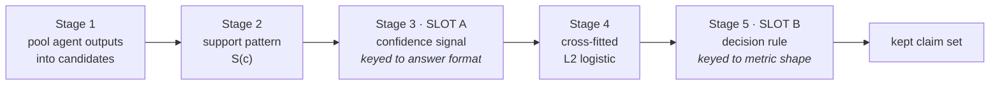

> **DRAFT — NOT SUBMISSION READY.** Numbers carry provenance markers as HTML
> comments (`claim` / `evidence` IDs) that are invisible when rendered and are
> stripped on migration to Overleaf. Reference verification status is recorded in
> `source_manifest.json`; references marked ‡ have **not** been read directly and
> must not enter the bibliography until they are. Open blockers are in
> `UNRESOLVED.md`. Authors omitted for anonymous review.

# Who Said It Is Not Enough: Output-Structure Signals for Multi-Agent Aggregation of Set-Valued Answers

*Alternative titles under consideration: "A Ceiling on Reliability Weighting for
Set-Valued LLM Aggregation"; "Reading How an Agent Answered, Not Just Which Agent
Answered".*

---

## Abstract

Ensembles of large language models are typically combined by majority voting or a
reliability-weighted variant of it, both of which were designed for a single
categorical label. Many questions do not have one. Their answers are sets — a list
of entities, or a paragraph containing many separable facts — and an aggregator
must decide, claim by claim, what to keep. We first establish a limit on the
standard approach: any aggregation rule that reads only *which* agents asserted a
claim is bounded by a direct estimate of `P(correct | that exact asserting
subset)`, a class that contains reliability weighting, correlation-aware weighting,
and Dawid–Skene annotator models. On QAMPARI that bound is worth +0.30 set F1 over
plain support counting and its bootstrap interval includes zero. <!-- [claim:C001] [evidence:E100] -->
We then describe an aggregation template with two task-typed slots: a per-claim
confidence signal, keyed to the answer format, and a decision rule, keyed to the
shape of the evaluation metric. Instantiated for list answers, the confidence slot
holds two signals we introduce — the position a claim occupies inside its own
asserting agent's output, and how much each *silent* agent said — and the decision
slot holds a per-question keep-count chosen by plug-in expected F1. This reaches
31.70 F1 against 27.40 for the best single agent (+15.7%) and 29.21 for multi-agent
counting (+8.5%), both significant under a paired bootstrap over questions, and
31.49 (+2.29 over counting) when every training fold excludes the held-out question
type entirely. <!-- [claim:C002] [evidence:E100,E101] -->
On ASQA the same template loses to reliability weighting at every ensemble size.
That reversal is predicted before any method is built by a single statistic
computable from cached generations, and we trace it to a measured absence of the
position signal at ASQA's response lengths. Which aggregation rule wins is a
property of the answer format, and it can be screened for in advance.

---

## 1 Introduction

### 1.1 Motivation

Running several language models on the same question and combining their outputs is
now routine, and the combination step is usually a vote over whole responses
[@E003]‡ or a learned selection or fusion of them [@E004]. Both assume the objects
being combined are comparable as wholes — that two responses either agree or do
not.

Set-valued answers break that assumption. Asked which manga a given artist drew, a
model returns a list; asked an ambiguous question, it returns a paragraph covering
several interpretations. The unit that can be right or wrong is not the response but
the individual claim inside it, and two responses typically overlap partially rather
than coinciding. Aggregation must therefore operate at claim level: pool the claims
every agent produced, then decide which to keep.

Doing this badly is worse than not aggregating at all. On our QAMPARI pool, a strict
majority vote over pooled claims scores 22.80 set F1 while the single best agent
scores 27.92 — the ensemble costs eight times the inference and loses ground. <!-- [claim:C003] [evidence:E121] -->
Response-level selection fares no better in a different way: with open-ended
answers no two responses coincide, so a global-weight selection rule always returns
the highest-weighted agent and reproduces best-single exactly, at +0.00 with a
zero-width confidence interval. <!-- [claim:C004] [evidence:E121] -->

### 1.2 Context and the gap

Three lines of work bear directly on this and none of them covers it.

**Weighted voting over agents.** Recent work derives provably optimal aggregation
weights from higher-order information about agent agreement [@E002]. The derivation
targets binary and categorical predictions. On set-valued answers the rule is not
merely weak but undefined in its published form: the log-odds weight
`log(p / (1 - p))` requires per-agent accuracy above 0.5, whereas per-*claim*
precision in our pool runs from 5.8% to 28%, so every weight is negative and the
optimal threshold switches the filter off. <!-- [claim:C005] [evidence:E002,E121] -->

**Atomic self-consistency.** ASC decomposes long-form answers into atomic units,
clusters them, and keeps clusters whose member count exceeds a validation-tuned
threshold [@E001]. It handles set-valued answers directly, and it is the closest
published system to ours. But its m samples come from one model, so *who* said a
claim does not exist as a variable, and neither does anything about how a
particular agent said it.

**Claim-level cross-model filtering.** Systems that check claims from one model
against samples from others exist [@E006], as do multi-agent long-form factuality
evaluators [@E023]‡ [@E024]‡. These score or filter claims for factuality
assessment; they do not use a claim's placement inside the generating model's own
output, treat an agent's silence as graded evidence, or choose how many claims to
return.

**The gap.** There is no principled account of how to weight heterogeneous agents
when the answers are sets, and no statement of what such weighting can and cannot
buy.

### 1.3 Insight and research questions

Our starting observation is that the entire weighting literature reads one object:
the set of agents that asserted a claim. Call it the claim's *support pattern*. Any
rule computed from the support pattern alone — a weighted sum with a threshold, a
Naive Bayes model over per-agent true- and false-positive rates, a correlation-aware
variant, a Dawid–Skene annotator model [@E017]‡ — is a function of that one object.
The best such function is a direct estimate of `P(correct | support pattern)`, so
estimating it and thresholding it bounds the class. Measuring that bound converts an
open design space into a single number.

The bound says nothing about a second, disjoint source of information: how each
agent *presented* the claim inside its own output. That is what we exploit.

- **RQ1.** How much can reliability weighting over agents improve aggregation of
  set-valued answers, and what bounds it?
- **RQ2.** If the bound binds, what information lies outside it, and is it enough
  to clear the bound?
- **RQ3.** Can we tell in advance, from cached generations and before building
  anything, which of the two regimes a benchmark is in?

### 1.4 Method summary

We describe a five-stage aggregation template. Three stages are fixed: pooling
claims into candidates, computing the support pattern, and fitting a cross-fitted
L2-regularised logistic regression over the assembled features. Two are slots whose
contents are determined by a stated property of the task. The **confidence slot**
holds whatever per-claim signal the answer format affords; for list answers we fill
it with the claim's rank inside each asserting agent's own list, per-agent rank
bands, and *omission strength* — each silent agent weighted by the logarithm of how
much it said on that question. The **decision slot** holds a rule matched to the
metric; for set F1 we use a per-question keep-count
`k*(q) = argmax_k 2 · (Σ_{i≤k} p_i) / (k + Ĝ_q)`, the plug-in expected F1, with
`Ĝ_q` a ridge-predicted gold-set size fitted on training questions only.

### 1.5 Contributions

1. **A ceiling on reliability weighting for set-valued aggregation.** We show by
   construction that every rule reading only the support pattern is bounded by a
   direct lookup of `P(correct | support pattern)`, and measure that bound at +0.30
   set F1 over plain counting on QAMPARI, with a bootstrap interval of
   [−0.34, +0.90]. <!-- [claim:C006] [evidence:E100] -->
2. **An aggregation template with two task-typed slots**, and a statement of which
   property of the task fixes each: the answer format fixes the confidence signal,
   the metric fixes the decision rule.
3. **An instantiation for list answers that clears the ceiling**, using a logistic
   regression over 92 features and a closed-form keep-count: 31.70 F1, +4.30 over
   the best single agent and +2.50 over counting, both with bootstrap intervals
   excluding zero. <!-- [claim:C007] [evidence:E100] -->
4. **Two signals with no prior art we could find**: within-output position as a
   per-claim correctness signal, and graded omission. We report both with their
   measured limits, including the finding that the position signal is absent on
   short lists.
5. **Robustness evidence and a rejected component.** The gain survives holding out
   an entire question type; gradient boosting over the same features is better
   in-distribution and worse out of it, so we report it as a rejected ablation
   rather than part of the method.
6. **A screen that predicts the regime in advance.** The *solo ratio* —
   `P(correct | exactly one agent asserts) / P(correct | at least two assert)` —
   orders our three benchmarks correctly, and we show the two per-ensemble sweeps
   it predicts are mirror images of each other.

---

## 2 Background

All notation used later is introduced here.

**Task.** A pool of `n` agents `M = {m_1, …, m_n}` each answers question `q` once,
producing an ordered sequence of claims. Claims are normalised and pooled into a
candidate set `C(q)`; a candidate `c` is *asserted* by agent `m` if `m` produced a
claim that normalises to `c`. The aggregator outputs a subset of `C(q)`, scored
against a gold set `G(q)`.

**Support pattern.** `S(c) ⊆ M` is the set of agents asserting `c`. Its cardinality
`|S(c)|` is the *support count*. `S(c)` also determines who stayed silent, `M \ S(c)`.

**Within-output position.** `r_m(c)` is the 1-indexed position of `c` in agent `m`'s
own output for `q`, defined only for `m ∈ S(c)`. `L_m(q)` is the number of claims
agent `m` produced for `q`. Both are properties of the generating agent's output,
not of any list supplied to it.

**Metrics.** On QAMPARI we report set F1 against `G(q)`, macro-averaged over
questions. On ASQA we report `DR* = sqrt(ROUGE-L × STR-EM)`, a proxy for the
published DR; the published DR is the geometric mean of ROUGE-L and Disambig-F1,
and the ASQA authors state that STR-EM and Disambig-F1 measure the same aspect,
which is what licenses the substitution [@E012]. The proxy avoids standing up a
RoBERTa-SQuADv2 reader and is labelled as a proxy throughout. <!-- [claim:C008] [evidence:E116,E012] -->
On TriviaQA we report accuracy.

**Baselines used as reference points.**

- *Best single agent* — the pool member with the highest mean score, selected on
  the same cross-fitting protocol as every other arm.
- *Multi-agent count* — keep `c` if `|S(c)| ≥ θ`, with `θ` fitted on training folds.
  This is our own naive baseline, not a published method.
- *Reliability weighting* — keep `c` if `Σ_{m ∈ S(c)} w_m ≥ Θ`, with per-agent
  weights fitted on training folds.
- *Pattern lookup* — keep `c` if the training-fold estimate of
  `P(correct | S(c) = s)` exceeds a fitted threshold. This is the ceiling of §3.1,
  and in substance a Dawid–Skene annotator model applied to LLM agents [@E017]‡;
  we present it as a baseline drawn from the crowdsourcing literature, not as our
  contribution.
- *Atomic self-consistency* — the published ASC pipeline [@E001].

---

## 3 Method

### 3.1 The support pattern and its ceiling

Consider any aggregation rule whose keep/drop decision for candidate `c` depends on
`c` only through `S(c)`. Weighted voting with per-agent weights is such a rule; so
is a Naive Bayes model over per-agent true- and false-positive rates, with or
without silence entered as evidence; so is any correlation- or diversity-aware
weighting, because the pairwise co-assertion structure it reads is itself a function
of `S(c)`; and so is a Dawid–Skene annotator model [@E017]‡.

Because the rule sees only `S(c)`, it induces a partition of candidates into at most
`2^n` cells and applies one decision per cell. For any objective that is monotone in
the probability a kept claim is correct, the best decision within a cell is
determined by `P(correct | S(c) = s)`. Estimating that quantity directly on training
folds and thresholding it is therefore the best rule in the class, up to estimation
error. Support counting is itself a member of the class, obtained by restricting
attention to `|S(c)|`.

Two consequences. First, the value of *all* reliability weighting on a given dataset
is a single measurable number: how much the pattern lookup beats plain counting.
Second, the argument is a construction rather than an empirical claim, so a negative
measurement is informative rather than a failure to find a better weighting scheme.

The construction bounds the *population* optimum of the class. With finite data the
lookup must estimate up to `2^n` cells, so a constrained rule can beat it in sample.
We observe exactly this on ASQA (§5.5) and treat it as a statement about data volume
rather than a counterexample to the construction. <!-- [claim:C009] [evidence:E103] -->

### 3.2 A template with two typed slots



Stages 1, 2 and 4 are identical across every benchmark we run. Stage 1 varies
mechanically with how answers are delimited — normalised entity strings for list
answers, sentence clusters for prose, distinct terse answers for short-answer QA —
and Stages 3 and 5 are the two genuine slots.

| stage | QAMPARI | ASQA | TriviaQA | fixed by |
|---|---|---|---|---|
| 1 pool to units | normalised entity strings | sentence clusters | distinct terse answers | answer format |
| 2 support pattern | identical | identical | identical | — |
| **3 confidence signal** | list rank + omission | sentence position | self-consistency | **answer format** |
| 4 cross-fitted logistic | identical | identical | identical | — |
| **5 decision rule** | per-question budget | swept threshold | argmax | **metric shape** |

Naming two slots rather than one matters, because they are keyed to different
properties. The metric decides Stage 5: set F1 admits a keep-count, a recall-only
metric does not, and a single-answer metric admits only an argmax. The answer format
decides Stage 3: position inside a list exists only when the agent emitted a list.

The template also carries a **precondition**, which §3.6 makes operational: Stage 3
is only worth filling where the ceiling of §3.1 binds.

### 3.3 The confidence slot for list answers

For list answers we fill Stage 3 with three feature groups, all computed from the
agents' own outputs and none of them a function of `S(c)` alone. Exact definitions
are in Appendix B; the feature construction is a single function in the released
code. <!-- [claim:C010] [evidence:E113] -->

**Within-output position.** For each asserting agent, `log(1 + r_m(c))` and the
relative position `r_m(c) / L_m(q)`, summarised across asserters by minimum, mean,
maximum and standard deviation, plus one per-agent position feature so the model can
learn that position means different things for different agents.

**Per-agent position bands.** A one-hot encoding of `r_m(c)` into seven bands per
agent, which lets the scorer express a non-monotone dependence on position without a
non-linear model.

**Omission strength.** Every prior rule we are aware of treats silence as one thing:
a Naive Bayes model assigns every silent agent the same
`log((1 - TPR) / (1 - FPR))`, and a logistic over support indicators assigns it
zero. But list lengths in this pool span a median of 1 for the smallest agent to a
mean of 72.2 for the largest. <!-- [claim:C011] [evidence:E107] --> An agent that
emitted three items and did not mention `c` has barely spoken; an agent that emitted
fifty and did not mention `c` has said a great deal about `q` without saying `c`. We
therefore weight each silent agent by `log L_m(q)` and enter the sum, the maximum,
the count of silent agents with `L_m(q) ≥ 20`, and one per-agent term. This is our
own construction; we are not aware of prior work that uses it, and we make no claim
that prior work supports it.

**Stacked pattern probability.** The training-fold estimate of
`P(correct | S(c) = s)`, entered as a single logit-scaled feature, so the scorer
receives the ceiling arm's own output as an input rather than competing with it.

**Scorer.** An L2-regularised logistic regression (ridge coefficient 1.0) over 92
features. <!-- [claim:C012] [evidence:E113,E114] --> Verbosity of the *asserting*
agents is deliberately excluded: it adds +0.01 over position and is ablated out
(Appendix B). List length survives only inside omission strength, where a silent
agent has no position and length is the only evidence available.

*Rejected component.* Histogram gradient boosting over the same features, with early
stopping on a held-out slice of the training fold, produces better in-distribution
scores (§5.2) and transfers worse (§5.4). It is not part of the method and is
reported as the ablation that justifies the choice.

### 3.4 The decision slot for set F1

Scoring claims produces an ordering; something must still decide how far down it to
cut. Gold set sizes on QAMPARI range from 5 to 40 with a mean of 10.2, so a single
global threshold is wrong on most questions. <!-- [claim:C013] [evidence:E112] -->

For a metric that is an F1 over sets, take the candidates in descending predicted
probability `p_1 ≥ p_2 ≥ …`, substitute `Σ_{i≤k} p_i` for the unknown number of
correct claims among the top `k`, and substitute `Ĝ_q` for the unknown gold size:

```
k*(q) = argmax_k  2 · (Σ_{i ≤ k} p_i) / (k + Ĝ_q)
```

`Ĝ_q` is a ridge regression fitted on training questions only, over question-level
quantities available at inference: the number of candidates, the maximum support
count on that question, how many candidates have at least two supporters, the sum of
predicted probabilities, and the maximum predicted probability.

The estimate need not be accurate. Its mean absolute error is 4.62 against a gold
mean of 10.2; substituting the *true* gold count gains only +0.55; and a single
constant `k` fitted across all questions gains nothing at all over counting (29.41
against 29.21). <!-- [claim:C014] [evidence:E112,E100] --> The operative property is
that the cut *varies* per question, not that it is close to correct.

### 3.5 Cross-fitting

Every fitted object — the pattern lookup, the logistic coefficients, the gold-count
ridge, per-agent weights, and every threshold — is fitted on training folds and
applied to held-out questions. We use 5 folds over questions on QAMPARI and 2 on
ASQA, where each threshold evaluation costs a ROUGE-L pass. Confidence intervals are
paired bootstrap over questions, 10,000 resamples.

This is not a formality on this data. Selecting a keep threshold on the evaluation
set rather than on training folds moved one measured gain from +0.08 to −1.25. <!-- [claim:C015] [evidence:E111] -->
We therefore treat any in-sample tuned number as uninformative.

### 3.6 Screening a dataset before filling the slot

The confidence slot is expensive to fill: it requires deciding what signal the format
affords, implementing it, and labelling enough claims to fit a scorer. §3.1 says it
is only worth filling where the ceiling binds. The following statistic, computable
from cached generations with no model calls and no method work, estimates that:

```
solo ratio = P(correct | exactly 1 agent asserts) / P(correct | ≥ 2 agents assert)
```

A low ratio means a solo claim is strong evidence of being wrong, so thresholding on
support count is already a good filter and weighting has little left to add — the
regime where the remaining signal must come from somewhere else. A high ratio means
counting discards most of the content for little precision gain, so weighting is the
only thing that can filter. Note that the *share* of solo candidates does not carry
this information: it is roughly 87% on both QAMPARI and ASQA. <!-- [claim:C016] [evidence:E118] -->

---

## 4 Experiments

### 4.1 Benchmarks

**QAMPARI** [@E013]‡ — 777 questions with entity-list answers, scored by set F1.
Each list item is natively an atomic fact, so no sentence splitting and no
summarisation step is required, and the aggregator's output cannot contain content
absent from some agent's response. Grading is programmatic against gold aliases with
no judge model. **Caveat:** 97.2% of gold entries ship no alias beyond the answer
text, so grading is close to exact string match and correct answers phrased
differently score zero. A strict-versus-relaxed sensitivity analysis puts this at
roughly −7 F1 across every arm, with no conclusion changed; the penalty is close to
uniform. <!-- [claim:C017] [evidence:E119] --> We report it rather than relaxing it
silently.

QAMPARI questions come from five structurally different sources
(`wikidata_simple`, `wikidata_intersection`, `wikidata_comp`,
`wikitables_composition`, `wikitables_simple`), which we use for the
distribution-shift protocol in §5.4. <!-- [claim:C018] [evidence:E101] -->

**ASQA** [@E012] — 400 ambiguous questions with long-form answers, decomposed into
sentence clusters, scored by the `DR*` proxy of §2.

**TriviaQA** — 2,757 short-answer questions, scored by accuracy. Within-output
position and the keep-count are both undefined here, since each response is a single
answer; TriviaQA enters only as a third point for the screen of §3.6 and as the
benchmark where the confidence slot is filled by self-consistency.

### 4.2 Agent pool

Eight agents on QAMPARI: `grok-4.3`, `Kimi-K2.5`, `MAI-Thinking-1`, `gpt-5.4`,
`DeepSeek-V4-Flash`, `gpt-5.4-mini`, `gpt-5.4-nano`, `Cohere-command-a-plus-05-2026`.
Six on ASQA: `DeepSeek-V4-Flash`, `MAI-Thinking-1`, `gpt-5.4`, `gpt-5.4-mini`,
`gpt-5.4-nano`, `grok-4.3`. <!-- [claim:C019] [evidence:E115,E104] --> Six on
TriviaQA. Every agent is sampled once per question at a single decoding setting, and
all generations are cached; every result in this paper is computed from that cache
with no further model calls.

Per-agent list-length statistics on QAMPARI, which the omission feature relies on:

| agent | median `L` | mean `L` | max `L` |
|---|---|---|---|
| Kimi-K2.5 | 13 | 72.2 | 2431 |
| DeepSeek-V4-Flash | 7 | 28.5 | 2398 |
| gpt-5.4-nano | 1 | 24.3 | 1067 |
| gpt-5.4 | 6 | 18.9 | 562 |
| MAI-Thinking-1 | 8 | 15.3 | 658 |
| grok-4.3 | 7 | 10.4 | 400 |
| Cohere-command-a-plus | 3 | 6.7 | 140 |
| gpt-5.4-mini | 3 | 4.9 | 77 |

*Table 1. Agents differ by more than an order of magnitude in how much they emit per
question, which is what makes an agent's silence gradable rather than binary.* <!-- [claim:C020] [evidence:E107] -->

### 4.3 Baselines

Beyond the reference points of §2 we run the full reliability-weighting family
(marginal per-agent precision, solo precision, Naive Bayes with and without silence
as evidence, correlation-aware weighting, and the pattern lookup as the ceiling) and
the classical rank-fusion rules (Reciprocal Rank Fusion [@E031]‡, Borda, CombSUM,
CombMNZ), which a reader familiar with information retrieval will expect to see.

For ASC we run the published list pipeline. We verified against the paper that ASC's
list configuration has **no** LLM composition step — its final answer is the list of
selected cluster representatives — so our no-composition configuration is the
paper's list pipeline rather than a truncation of it. <!-- [claim:C021] [evidence:E120,E001] -->
One substitution remains and must be stated: ASC draws m stochastic samples from one
model, while our cache holds one response per agent, so agents stand in for samples.
That changes the estimand from self-consistency to inter-model agreement. The
single-model form is not evaluated here.

### 4.4 Protocol

5-fold cross-fitting over questions on QAMPARI, 2-fold on ASQA. Paired bootstrap
over questions, 10,000 resamples, 95% intervals; `*` marks an interval excluding
zero. The per-ensemble sweeps evaluate all 210 subsets of sizes 3–6 on QAMPARI and
all 42 subsets of sizes 3–6 on ASQA.

**One data-hygiene note.** A subset of generations from one agent contained literal
special-token strings that survived into the parsed item lists. Normalisation mapped
them to unmatched candidate strings — 1,244 of 110,801 candidates, none of which
matched gold — which both padded every arm's precision denominator and, more
importantly, split candidates that should have merged: a claim emitted by that agent
with a leaked prefix and by another agent without one counted as two candidates with
support 1 rather than one candidate with support 2. Stripping the tokens leaves
110,136 candidates and changes every arm by at most 0.14 F1, with no significance
verdict altered; the margin of our method over counting grew from +2.39 to +2.50.
All QAMPARI numbers in §5 are post-fix unless explicitly marked otherwise. <!-- [claim:C022] [evidence:E117,E100] -->

---

## 5 Results and Analysis

The underlying QAMPARI pool after pooling and normalisation is 110,136 candidate
claims across 777 questions, of which 3.57% are correct and 96,548 (87.6%) are
asserted by exactly one agent. <!-- [claim:C023] [evidence:E100] -->

### 5.1 RQ1 — What reliability weighting is worth, and its bound

| arm | set F1 | vs best single | vs count |
|---|---|---|---|
| best single agent (`Kimi-K2.5`) | 27.40 | (reference) | −1.80 |
| multi-agent count, `θ` cross-fitted | 29.21 | +1.80 [+0.76, +2.87] \* | (reference) |
| **pattern lookup — ceiling on all weighting** | **29.50** | +2.10 [+1.09, +3.09] \* | **+0.30 [−0.34, +0.90]** |
| ours: scorer only, global threshold | 30.68 | +3.28 [+2.31, +4.26] \* | +1.47 [+0.78, +2.14] \* |
| **ours: scorer + per-question budget** | **31.70** | **+4.30 [+3.37, +5.26] \*** | **+2.50 [+1.72, +3.28] \*** |

*Table 2. QAMPARI, 777 questions, 8 agents, 5-fold cross-fitted by question, paired
bootstrap over questions with 10,000 resamples. The best rule expressible from the
support pattern alone — which upper-bounds every reliability-weighting scheme —
beats plain counting by +0.30 F1 with an interval of [−0.34, +0.90]. The data
therefore rule out gains above roughly +0.9 F1 for any rule in that class, and do
not establish that the gain is zero. Everything above that line comes from
information the support pattern does not contain.* <!-- [claim:C024] [evidence:E100] -->

This is the answer to RQ1, and it takes the form of a bound rather than a null: at
95% the data place any rule in the class at no more than about +0.9 F1 over plain
counting on this benchmark. It is stronger than
"the weighting schemes we tried did not work", because the pattern lookup is not one
scheme among many: by §3.1 it bounds the whole class. The bound is on that class's
*population* optimum, and §3.1 notes that the estimated lookup can be beaten in
sample where cells are thin; §5.5 reports the one benchmark where that happens. The
sweep behind the measurement is consistent with it —
correlation and diversity weighting selected `λ = 0` in all five folds, an explicit
pairwise co-assertion parameterisation with 28 indicators gained +0.05, and
question-domain weights gained +0.00. <!-- [claim:C025] [evidence:E111] --> Those
are three different ways of reaching the bound from below.

The support-count profile shows why counting already does most of the available
filtering here. `P(correct | exactly k agents assert)` runs 1.2 / 11.1 / 17.4 /
27.2 / 36.5 / 46.3 / 51.9 / 56.5 percent for k = 1…8. <!-- [claim:C026] [evidence:E122] -->
A solo claim is almost certainly wrong and two agreeing agents raise the odds by
roughly an order of magnitude, so a threshold on support count is close to the best
this class of information supports.

### 5.2 RQ2 — What lies outside the bound

The lower two rows of Table 2 answer RQ2. Adding the confidence slot moves the score
from 29.21 to 30.68 with a global threshold, and the decision slot adds a further
1.02 to reach 31.70. Both increments have bootstrap intervals excluding zero, and
the two axes are close to independent: in the ablation sweep the confidence signals
alone are worth +1.44 over counting and the budget alone — implemented as
`adapt-count`, which uses *no* agent identity whatsoever — is worth +1.19. <!-- [claim:C027] [evidence:E111] -->
Agent identity is worth roughly +0.3 on top of either. The literature this work
extends places its weight on agent identity; on this task, the two signals that do
not use it are worth roughly five times as much as the one that does.

Within the confidence slot, omission strength is the single largest feature block:
adding it alone is worth +1.65 over counting. <!-- [claim:C028] [evidence:E111] -->

**Ablations, in-distribution.** Gradient boosting over the same features scores 29.95
alone and 31.73 with the budget; a logistic/GBM blend scores 30.80 and 32.06. <!-- [claim:C029] [evidence:E100] -->
The blended arm is therefore the best
in-distribution number we measured, and we do not report it as our result. §5.4 says
why.

**Off-the-shelf fusion.** Of the classical rank-fusion rules only Reciprocal Rank
Fusion beats counting, at +0.84; Borda, CombSUM and weighted Borda land between
−0.42 and −0.67, below counting. <!-- [claim:C030] [evidence:E111] --> RRF is the
strongest parameter-free baseline and is worth reporting as such.

### 5.3 Breadth — every ensemble, not one pool

A single 8-agent result invites the objection that the pool was favourable. We
therefore evaluate all 210 subsets of sizes 3–6.

| size | ensembles | best single | count | weighted | pattern | ours (scorer) | ours (+budget) |
|---|---|---|---|---|---|---|---|
| 3 | 56 | 24.72 | 22.15 | +2.25 | +2.73 | +4.12 | **+4.43** |
| 4 | 70 | 26.00 | 23.69 | +1.90 | +2.57 | +4.16 | **+4.53** |
| 5 | 56 | 26.77 | 26.17 | +0.40 | +1.13 | +2.74 | **+3.13** |
| 6 | 28 | 27.18 | 27.74 | −0.36 | +0.36 | +1.86 | **+2.31** |

| size | weighted | pattern | ours (scorer) | ours (+budget) |
|---|---|---|---|---|
| 3 | 39/56 | 45/56 | 56/56 | **56/56** |
| 4 | 39/70 | 44/70 | 70/70 | **70/70** |
| 5 | 20/56 | 23/56 | 50/56 | **56/56** |
| 6 | 7/28 | 7/28 | 21/28 | **28/28** |
| total | 105/210 | 119/210 | 197/210 | **210/210** |

*Table 3. Gain over multi-agent counting, averaged across all QAMPARI ensembles of
each size (upper), and the number of ensembles in which each arm beats counting with
a bootstrap interval excluding zero (lower). Our method beats counting significantly
in all 210 ensembles at every size, while reliability weighting manages 105 and turns
negative at size 6. The relative gain is largest where the pool is smallest, +20.0%
at n = 3. **These numbers predate the parsing fix of §4.4 and are pending
regeneration.*** <!-- [claim:C031] [evidence:E102] -->

The size-6 row also settles a question this project had previously framed as a
property of aggregation itself: the crossover at which weighting stops paying is a
property of **support-pattern rules specifically**. Weighting and the pattern lookup
both decay toward zero as the pool grows, and weighting goes negative; the
output-structure arms decay far more slowly and do not cross over anywhere we can
measure. <!-- [claim:C032] [evidence:E102] -->

### 5.4 Robustness

**Holding out a whole question type.** Random folds draw train and test from the same
question distribution, so a rule exploiting something peculiar to QAMPARI as a whole
would still look fine. We therefore train on four of QAMPARI's five question sources
and test on the fifth, five times.

| arm | random 5-fold | leave-one-source-out | shift | LOSO vs count |
|---|---|---|---|---|
| count | 29.21 | 29.21 | +0.00 | (reference) |
| pattern lookup | 29.50 | 29.44 | −0.06 | +0.24 [−0.38, +0.80] |
| ours: scorer | 30.68 | 30.57 | −0.11 | +1.36 [+0.66, +2.05] \* |
| **ours: scorer + budget** | **31.70** | **31.49** | **−0.21** | **+2.29 [+1.47, +3.10] \*** |
| logistic/GBM blend + budget | 32.29 | 31.43 | −0.86 | +2.22 [+1.40, +3.05] \* |

*Table 4. Under a complete change of question type, our method loses 0.21 F1 against
a gain of 2.50, so roughly 92% of the gain survives, and it remains significant
against counting. The boosted blend is the best arm under random folds and the worst
transfer of any arm, which is why it is not part of the method.* <!-- [claim:C033] [evidence:E101] -->

Two readings matter here.

*The extra capacity does not pay out of distribution.* The blend gains +0.36 over the
plain logistic under random folds and loses 0.06 to it under shift. We take the
out-of-distribution ordering as the decision-relevant one and drop boosting from the
method, reporting the boosted arms as the ablation that justifies the call. Reporting
a lower headline than our best measured number is the point of the exercise.

*Gains are positive on every held-out source.* Per-source gains for the blended arm,
each source held out entirely, run +1.41 (`wikidata_simple`, n = 327), +2.26
(`wikidata_intersection`, n = 164), +2.80 (`wikidata_comp`, n = 149), +3.31
(`wikitables_composition`, n = 84) and +3.73 (`wikitables_simple`, n = 53). <!-- [claim:C034] [evidence:E101] -->
The log reports this breakdown for the blended arm rather than for the method as
reported, which is a gap we intend to close.

**Correcting a claim from our own earlier write-ups.** Previous internal versions of
this work argued that the pattern lookup *collapses* under this shift — falling from
+0.25 to +0.02 — and read that as evidence the protocol detects memorisation while
our features survive it. It does not hold. Post-fix the pattern arm moves from +0.30
to +0.24, a shift of −0.06; and under either protocol, before or after, its interval
included zero, so the "collapse" was movement between two non-significant numbers.
The protocol does discriminate — it is what separates the boosted arm from the
plain one — but it does not indict the pattern lookup, and we do not claim it does. <!-- [claim:C035] [evidence:E101] -->

**How much supervision this needs.** Fitting the scorer requires labelled questions.
Holding out a fixed test set and drawing training subsets of increasing size, five
independent draws each, on two different test splits:

| training questions | split A | split B | spread across draws |
|---|---|---|---|
| 25 | −1.10 | +0.18 | ±1.64 |
| 50 | +0.62 | −0.20 | ±0.22 |
| 100 | +0.97 | +0.54 | ±0.21 |
| 200 | +1.10 | +1.00 | ±0.34 |
| 350 | +1.55 | +1.11 | ±0.15 |
| 527 | +1.45 | +1.28 | — |

*Table 5. Gain over counting as a function of training-set size. The gain saturates
by roughly 200 questions, and the draw-to-draw spread collapses from ±1.64 to ±0.15,
so by that point it no longer matters which questions were used for fitting. At 25
questions the method loses to counting. **The full-data gain here is below the
cross-fitted headline of §5.1 and that discrepancy is unresolved.*** <!-- [claim:C036] [evidence:E108] -->

The collapsing spread answers a specific objection: open-ended questions are all
different, so how can coefficients fitted on one set transfer to another? The
features are normalised by their own question's quantities, so the coefficients
describe how these models emit lists rather than the subject matter of any
particular question. The measurement is that by n ≈ 200 the identity of the training
questions stops mattering.

### 5.5 RQ3 — Predicting the regime, and the benchmark where we lose

The solo ratio of §3.6, computed from cached generations alone:

| benchmark | solo ratio | which arm wins |
|---|---|---|
| QAMPARI | 0.06 | output-structure signals |
| TriviaQA | 0.24 | output-structure signals (self-consistency) |
| ASQA | 0.47 | reliability weighting |

*Table 6. The solo ratio, `P(correct | exactly one agent asserts)` divided by
`P(correct | at least two assert)`, orders the three benchmarks in the same order as
the outcome. Pool heterogeneity does not: ASQA's pool is the most homogeneous of the
three (coefficient of variation 0.125 against QAMPARI's 0.439) and is where
weighting wins by the largest margin.* <!-- [claim:C037] [evidence:E118] -->

The strongest form of this evidence is that the two per-ensemble sweeps are mirror
images. On QAMPARI our method beats reliability weighting in all 210 ensembles. On
ASQA:

| ensemble size | ensembles | best single | count | weighted | ours |
|---|---|---|---|---|---|
| 3 | 20 | 26.58 | 25.88 | **26.71** | 26.59 |
| 4 | 15 | 26.60 | 25.30 | **26.74** | 26.51 |
| 5 | 6 | 26.59 | 24.70 | **26.90** | 26.48 |
| 6 | 1 | 26.53 | 24.27 | **27.01** | 26.35 |

*Table 7. ASQA under the `DR*` proxy, all 42 ensembles of sizes 3–6. Our method beats
counting everywhere (significantly in 29 of 42 ensembles, against weighting's 31 of
42) and loses to reliability weighting at every size, with the gap widening as the
pool grows — the exact reverse of Table 3, on the two same methods, predicted in
advance by Table 6.* <!-- [claim:C038] [evidence:E104] -->

We report this loss as a result rather than a caveat, and we can say why it happens.

**The confidence slot is empty on ASQA, and this was predicted before it was
measured.** The position signal on QAMPARI is conditional on list length. Restricting
to solo assertions, which removes the support confound, and stratifying by the
asserting agent's own list length, which removes the verbosity confound:

| asserter's list length | 1st quintile | last quintile | Spearman(rank, correct) |
|---|---|---|---|
| 1–5 items | 2.2% | 4.6% | +0.084 |
| 6–20 | 5.2% | 2.8% | −0.048 |
| 21–100 | 5.4% | 1.2% | −0.102 |
| 101+ | 0.9% | 0.1% | −0.069 |
| pooled solo | | | −0.121 |

*Table 8. On short lists there is no usable position signal — it is flat or mildly
reversed — and the gradient appears only on long lists. The feature pays on QAMPARI
because 70% of solo assertions sit in lists of 101 or more items. A control confirms
the effect is positional rather than verbosity in disguise:
`P(correct | first position)` by length band is 2.2 / 4.1 / 4.4 / 4.3 percent, which
is flat.* <!-- [claim:C039] [evidence:E105] -->

ASQA responses average 3.5 sentences and 79% are 3–4 sentences — squarely inside the
band where QAMPARI shows no signal. We made this prediction before running the
measurement, and it holds: Spearman correlation between sentence position and
correctness is −0.029 in the 3–4 sentence band (n = 4,064) and −0.047 pooled over
solo claims. <!-- [claim:C040] [evidence:E106] --> Our method loses on ASQA because
the slot it depends on is empty there, not because the template is wrong.

Two further observations sharpen this rather than soften it. First, the decision slot
is not the problem: metric-matched budget variants for ASQA score 24.98 to 26.70,
all below the swept threshold, so the failure is upstream in Stage 3. <!-- [claim:C041] [evidence:E103] -->
Second, on ASQA reliability weighting scores 27.45 against the pattern lookup's
27.20 — the constrained rule beats its own population bound by +0.25. With 6,015
clusters and 2^6 cells, the lookup is estimating on thin data, which is what §3.1
predicts should happen and is a second, independent reading of the same shortage. <!-- [claim:C042] [evidence:E103] -->

**Three points are an observation, not a law.** The solo ratio ordering is consistent
across the three benchmarks we have and is mechanistically connected to what the
counting filter can do, but we have not validated it on a benchmark held out from
its construction, and we do not claim more than an ordering.

### 5.6 Where the method is loose

Cross-fitted predicted probabilities are well calibrated where the mass sits and
overconfident where the decision is made:

| predicted `p` | claims | mean predicted | actual | gap |
|---|---|---|---|---|
| 0.00–0.02 | 81,541 | 0.4% | 0.4% | 0.0 |
| 0.02–0.05 | 12,278 | 3.2% | 4.0% | +0.8 |
| 0.05–0.10 | 6,925 | 7.1% | 7.5% | +0.5 |
| 0.10–0.20 | 3,876 | 13.8% | 13.4% | −0.5 |
| 0.20–0.35 | 2,401 | 26.9% | 26.1% | −0.9 |
| 0.35–0.50 | 1,602 | 42.1% | 39.5% | −2.6 |
| 0.50–0.70 | 1,323 | 58.7% | 55.1% | −3.6 |
| 0.70–1.00 | 190 | 74.8% | 68.9% | −5.8 |

*Table 9. Mean predicted probability against observed correctness, cross-fitted over
110,136 QAMPARI claims. Calibration is close to exact in the bottom bins, which hold
74% of all claims, and overconfident by up to 5.8 points in the top bin — which is
precisely the region the keep-count reads.* <!-- [claim:C043] [evidence:E110] -->

Because the budget substitutes `Σ p_i` for the unknown number of correct claims, this
overconfidence causes it to overstate expected hits for the kept set and biases `k`
toward keeping too much. This also reframes an earlier internal finding that isotonic
calibration changed nothing: a globally fitted isotonic curve is dominated by the
bottom bin, which is already accurate, and barely moves the 3,115 claims above 0.35
that the decision actually depends on. A recalibration weighted toward the high-`p`
region is untried. It cannot threaten the scorer's own result, since the ordering is
calibration-invariant and the 30.68 row of Table 2 stands regardless; only the +1.02
the budget adds depends on the sums being right.

### 5.7 Negative results

We report these because each rules out an approach a reader may otherwise assume was
untried. All are cross-fitted, all against counting on QAMPARI.

| rule | vs count | reading |
|---|---|---|
| error-correlation / diversity weighting | `λ = 0` in 5/5 folds | a function of the support pattern; §3.1 caps it |
| pairwise co-assertion, 28 indicators | +0.05 | the same conclusion reached discriminatively |
| rank agreement across agents | +0.07 | agents agreeing on *order* adds nothing further |
| question-domain weights | +0.00 | QAMPARI's five sources carry no weighting signal |
| Borda / CombSUM / weighted Borda | −0.42 to −0.67 | below counting; only RRF survives |
| within-question z-normalisation | −0.94 | destroys the cross-question information a global threshold needs |
| within-question percentile normalisation | −2.56 | same, more severely |
| learned per-question `k` | −3.71 | `k*` is close to unpredictable from question features |
| single constant `k` for all questions | +0.20 | the budget's value is adaptivity, not keeping less |
| alias merging, six thresholds | −0.02 to −1.30 | bad merges outnumber good at every threshold |
| isotonic calibration, global | −0.03 | see §5.6 for why this is not the null it looks like |

*Table 10. Negative results. **Sourced from the pre-fix sweep and pending
regeneration.*** <!-- [claim:C044] [evidence:E111] -->

The alias-merging row has a clean mechanism worth stating: string-similar QAMPARI
entities are usually genuinely different entities — sequels, people sharing a surname
— rather than aliases, and a false merge deletes a correct answer outright because
only the cluster representative survives. At a 0.70 threshold, 14 good merges came
with 413 bad ones. <!-- [claim:C045] [evidence:E111] --> The same asymmetry explains
why replacing edit-distance clustering with an LLM grouping call loses ground: it
correctly merges `Warner Bros`/`Warner Bros. Pictures` but also merges
`UMass Amherst`/`University of Nebraska`, at a 7.6% merge rate. <!-- [claim:C046] [evidence:E123] -->

Finally, one number that looks like available headroom and is not. Keeping the best
prefix per question, on the ordering the scorer already produces, scores 39.90. That
is the maximum of roughly 143 noisy prefix scores per question and is heavily
selection-biased; every honest attempt to collect it fell far short — a learned `k`
scored 25.64, a constant `k` 29.41, and three separate changes to the budget
objective each moved the result by at most 0.18. <!-- [claim:C047] [evidence:E111] -->
We report it as an artefact of post-hoc selection, not as a target.

---

## 6 Related Work

### 6.1 Aggregating outputs across multiple models

The line runs from majority voting over sampled responses [@E032]‡, through scaling
that voting with the number of agents [@E003]‡, to deriving aggregation weights from
higher-order agreement information [@E002]. A parallel branch selects or fuses whole
responses rather than voting: pairwise ranking with generative fusion [@E004], and
LLM-based selection of the most consistent response [@E014]‡. Theoretical work bounds
what any policy whose output is one of the members' answers can achieve [@E009].

*How ours differs.* This line's estimand is a discrete label or a whole response.
Ours is a claim, and our aggregator emits a set assembled from fragments of several
responses, so it is not bounded by any single member's answer. We take the weighting
question from this line and show that on set-valued answers the entire class it
belongs to is bounded, and by how much.

### 6.2 Decomposing long-form answers into claims

Self-consistency over sampled reasoning paths [@E032]‡ generalises to selecting the
most consistent response [@E014]‡ and then to clustering atomic units within
long-form answers and keeping clusters by member count [@E001]. Atomic decomposition
is now general infrastructure for factuality evaluation and calibration [@E007],
including multi-agent evaluators [@E023]‡ [@E024]‡ [@E025]‡, and cross-model
consistency checking at claim granularity [@E006]. A plain union of list answers has
been used for biomedical QA [@E010].

*How ours differs.* All of these draw their samples from one model, or use several
models only to *check* claims. Agent identity therefore does not exist as a variable.
We make it available, and one of our findings is that it is worth less than the
non-identity signals in the same feature set. We also note that ASC's own paper
concedes that LLM-based decomposition would produce better atomic units than its
sentence splitter and was too expensive; that limitation is shared by our ASQA
pipeline.

### 6.3 Estimating item-level reliability without labels

Annotator-reliability models originate in crowdsourcing [@E017]‡ [@E018]‡ [@E019]‡
and have been carried to deep ensembles [@E020]‡. A separate strand reads label-free
behavioural signals from the model itself: response length as a hallucination
detector [@E015]‡ [@E016]‡, and consistency under prompt perturbation as a
credibility measure [@E008] [@E021]‡ [@E022]‡. Position effects in language models
are well documented, but on the **input** side — which of a supplied set of labels a
model selects [@E005], locating items in a given list [@E026]‡, context position
[@E027]‡, and positional bias when reranking supplied candidates [@E028]‡ [@E029]‡.
Adaptive set sizing exists in conformal prediction, targeting coverage rather than F1
[@E030]‡.

*How ours differs, on three axes.* **Response level versus claim level:** the
behavioural-signal work scores whole responses; we score each claim. **Input position
versus output position:** every position-effect result above concerns a sequence
given *to* the model; our signal is the position of an item in the model's own
free-form output, which is a different phenomenon, and we verified this distinction
by reading the nearest work in full rather than inferring it from abstracts [@E005].
**Asserters versus abstainers:** the reliability literature models who said what; we
additionally grade *silence* by how much the silent agent said, which we are not
aware of prior work doing.

One directly relevant finding does concern generated position: a study of short- and
long-form factual alignment reports accuracy falling from 51.3% for the first
requested fact to 30.1% for the fifth across 16 models [@E011]. This is in tension
with our Table 8, which shows no gradient across the first five positions. The likely
reconciliation is that their setting *requests* a fixed number of facts, so later
positions are produced under pressure, while our short lists are self-truncated —
the model stopped because it had no more to give. In our long lists, where the model
is under enumerative pressure, the gradient reappears. We state this as a hypothesis
consistent with both measurements, not as an established explanation.

---

## 7 Conclusion

Reliability weighting over agents is the standard answer to multi-model aggregation,
and on set-valued answers its value is bounded by a quantity that can be measured in
one pass. We measured it: on QAMPARI the best rule expressible from the support
pattern beats plain counting by +0.30 set F1, with an interval containing zero. The
information that remains is in how each agent presented its own answer — where a
claim sits in the list that agent produced, and how much the agents that omitted it
said instead — and a scorer over those signals, plus a per-question keep-count
matched to the metric, reaches +4.30 over the best single agent and +2.50 over
counting, holds in all 210 agent subsets we tested, and keeps roughly 92% of its gain
when the held-out questions are of a type never seen in training.

The template that produces these numbers has two slots rather than one, and each is
keyed to a different property of the task: the answer format determines what
confidence signal exists, and the metric determines what decision rule is admissible.
On ASQA the first slot is empty, we lose to reliability weighting, and both the
outcome and the mechanism were predicted in advance — by a ratio computable from
cached generations, and by a measurement showing the position signal is absent at
ASQA's response lengths.

More broadly: when the unit of aggregation stops being the response and becomes the
claim, most of the usable signal turns out not to be about which model spoke.

---

## Limitations

*Required as a separate section at *ACL venues, where it sits below the conclusion and
does not count toward the page limit.*

- **The full method is demonstrated on one benchmark.** The confidence slot as
  instantiated requires list-structured output; the per-question keep-count requires
  a metric with a precision term. Neither is defined for single-answer tasks, and on
  ASQA the confidence slot does not clear the ceiling.
- **The screen rests on three benchmarks.** The solo ratio orders them correctly and
  we give a mechanism, but three points support an observation, not a law, and none
  of the three was held out from the screen's construction.
- **The position signal has a measured domain of validity.** It is flat or mildly
  reversed on lists of five items or fewer, and the QAMPARI gain depends on 70% of
  solo assertions sitting in lists of 101 or more items.
- **Supervision cost.** Every arm here is supervised, including all baselines
  (counting's `θ`, ASC's `Θ`, the weighting family's per-agent weights), so the
  comparison is fair — but our label appetite is larger: 92 coefficients plus a ridge
  regression against a single integer. The learning curve places a floor at roughly
  50 questions and saturation at roughly 200.
- **The keep-count is fed by overconfident probabilities** in exactly the region it
  reads, biasing it toward keeping too much. A high-`p` recalibration is untried.
- **The ASC baseline substitutes agents for stochastic samples**, because the cache
  holds one response per agent. This changes the estimand from self-consistency to
  inter-model agreement. The published single-model form is not evaluated.
- **The ASQA metric is a proxy.** `DR* = sqrt(ROUGE-L × STR-EM)` substitutes STR-EM
  for Disambig-F1; a faithful DR requires a RoBERTa-SQuADv2 reader.
- **QAMPARI grading is close to exact string match.** 97.2% of gold entries ship no
  aliases, costing roughly 7 F1 across every arm approximately uniformly.
- **All agents are proprietary API models sampled once at a single decoding setting.**
  We do not measure sensitivity to temperature or to repeated sampling.
- **Two result tables predate a parsing fix.** The 210-ensemble sweep (Table 3) and
  the negative-results sweep (Table 10) were computed before the normalisation fix
  described in §4.4 and are pending regeneration; the fix moved every affected
  QAMPARI arm by at most 0.14 F1 and altered no significance verdict where it has
  been rerun, but that is an expectation for these two tables rather than a
  measurement.

---

## Appendix

**A. Per-ensemble results.** All 210 QAMPARI and 42 ASQA ensembles, with per-ensemble
scores and bootstrap verdicts.

**B. Feature definitions and controls.** The exact 115-feature construction, the
92-feature subset used by the method, the seven per-agent position bands, and the
controlled analysis separating position from verbosity that justifies excluding the
asserting agents' list lengths.

**C. Per-agent statistics.** Per-agent F1, list-length distributions, and solo
precision on each benchmark.

**D. Prompts** used for generation, per benchmark.

**E. Hyperparameters.** Ridge coefficient, fold counts, bootstrap settings, threshold
grids, and the gradient-boosting settings used for the rejected ablation.

**F. Extended negative results**, including the full weighting sweep.

**G. A worked keep-count.** The expected-F1 curve candidate by candidate for one
held-out question, showing the chosen `k` against the true optimum and against
keeping everything.

---

## References

Status is recorded in `source_manifest.json`. **‡ marks a reference that has not been
read directly and must not enter the bibliography until it has been** — search-result
summaries are not a citable source.

**Read directly and verified.**

- [E001] Atomic Self-Consistency for Better Long Form Generations. arXiv:2405.13131 (EMNLP 2024).
- [E002] Beyond Majority Voting: LLM Aggregation by Leveraging Higher-Order Information. arXiv:2510.01499.
- [E004] LLM-Blender: Ensembling Large Language Models with Pairwise Ranking and Generative Fusion. arXiv:2306.02561.
- [E005] Serial Position Effects of Large Language Models. arXiv:2406.15981.
- [E006] Zero-knowledge LLM hallucination detection through fine-grained cross-model consistency (Finch-Zk). arXiv:2508.14314.
- [E007] Atomic Calibration of LLMs in Long-Form Generations. arXiv:2410.13246.
- [E008] Is This Your Final Answer? Cross-Contextual Consistency as a Measure of LLM Credibility. arXiv:2608.10315.
- [E009] Power and Limitations of Aggregation in Compound AI Systems. arXiv:2602.21556.
- [E010] Harnessing Collective Intelligence for Biomedical Question Answering. arXiv:2508.01480.
- [E011] The Curious Case of Factual (Mis)Alignment between LLMs' Short- and Long-Form Answers. arXiv:2510.11218.
- [E012] ASQA: Factoid Questions Meet Long-Form Answers. arXiv:2204.06092 (EMNLP 2022).

**Not yet read directly — ‡, must be read before submission.**

- [E003]‡ More Agents Is All You Need. arXiv:2402.05120.
- [E013]‡ QAMPARI. arXiv:2205.12665.
- [E014]‡ Universal Self-Consistency. arXiv:2311.17311.
- [E015]‡ The Illusion of Progress: Re-evaluating Hallucination Detection in LLMs. arXiv:2508.08285.
- [E016]‡ Verbosity ≠ Veracity. arXiv:2411.07858.
- [E017]‡ Dawid & Skene, Maximum Likelihood Estimation of Observer Error-Rates Using the EM Algorithm (1979) — bibliographic details to be confirmed against the source.
- [E018]‡ Fast Dawid-Skene. arXiv:1803.02781.
- [E019]‡ Crowd-Certain: Label Aggregation in Crowdsourced and Ensemble Learning. arXiv:2310.16293.
- [E020]‡ Improving Deep Ensembles by Estimating Confusion Matrices. arXiv:2503.07119.
- [E021]‡ Prompt-Reverse Inconsistency. arXiv:2504.01282.
- [E022]‡ Self-consistency under prompt transformations. arXiv:2305.14279.
- [E023]‡ MAD-Fact. arXiv:2510.22967.
- [E024]‡ FaStfact. arXiv:2510.12839.
- [E025]‡ VeriFact. arXiv:2505.09701.
- [E026]‡ The Position Curse: LLMs Struggle to Locate the Last Few Items in a List. arXiv:2605.07127.
- [E027]‡ Lost in the Middle follow-up. arXiv:2510.10276.
- [E028]‡ LLM-based Listwise Reranking under Positional Bias. arXiv:2604.03642.
- [E029]‡ EviRank. arXiv:2606.04727.
- [E030]‡ Adaptive Coverage Policies in Conformal Prediction. arXiv:2510.04318.
- [E031]‡ Reciprocal Rank Fusion (Cormack, Clarke & Buettcher, SIGIR 2009) — bibliographic details to be confirmed against the source.
- [E032]‡ Self-Consistency Improves Chain of Thought Reasoning in Language Models. arXiv:2203.11171.

**Do not cite.** Input-side position-effect work must not be cited in support of the
within-output position signal — lost-in-the-middle, LLM-as-judge position bias,
listwise reranking bias, and recommender candidate-position bias all concern position
in the model's *input*. [E005] is cited as the contrast, not as support.
